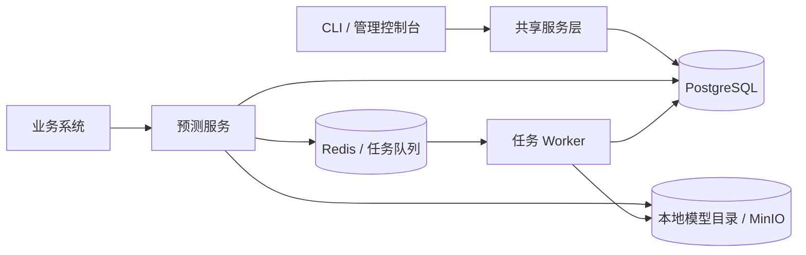

# 系统架构

Datamind 由管理入口、预测服务和任务 Worker 组成。管理入口维护模型与发布配置，预测服务处理在线请求，任务 Worker 执行批量和影子任务。各组件共享数据库与模型文件存储。

## 管理入口

系统提供两种管理入口，共用服务层，统一校验权限、资源状态和关联约束，并保存配置及审计记录。

- **[命令行工具（CLI）](../cli/index.md)**：通过命令行执行管理操作，适合脚本调用和自动化流程。
- **[管理控制台](../guides/console.md)**：通过浏览器管理资源，查看运行状态及预测记录。

## 预测服务

- **服务职责**：提供 HTTP 接口，负责认证、路由决策、模型加载和在线预测。一个服务可包含多个 Worker，各自维护模型和运行状态。接口说明请参阅[预测 API](../reference/runtime-api.md)。
- **部署生效**：启用部署后，预测服务 Worker 根据共享的期望状态加载模型，并上报运行实例状态。发布时需同时确认部署配置和实际加载状态。具体说明请参阅[部署与运行](../deployment/index.md)。
- **请求分配**：依次按指定部署、运行中实验、普通路由和默认部署选择主目标，再独立解析影子路由。具体过程请参阅[流量分配与决策优先级](../routing/index.md)。
- **预测结果**：根据任务类型返回类别、概率或评分，并通过请求、决策和执行记录关联所用版本与部署，支持结果追踪和后续分析。响应字段请参阅[预测 API](../reference/runtime-api.md#单条预测)，任务示例请参阅[评分与分类](../guides/scoring-and-classification.md)。

## 异步任务

批量预测和影子预测通过 Redis 消息队列交给[任务 Worker](../deployment/worker.md)执行，任务状态、结果和错误写入数据库。

- **[批量预测](../guides/batch-prediction.md)**：提交后返回排队状态，调用方通过查询接口获取执行进度和预测结果。
- **[影子预测](../deployment/shadow.md)**：复用主预测输入，独立执行候选版本，结果保存在执行记录中；客户端仍接收主部署的预测结果。

仅使用在线预测时，无需启动任务 Worker。异步任务的配置与运行方式，请参阅[任务 Worker](../deployment/worker.md)。

## 数据存储

| 组件             | 存储内容                                                           |
|------------------|--------------------------------------------------------------------|
| PostgreSQL       | 管理资源、运行控制、实验分配、请求、决策、执行、任务状态和审计记录 |
| Redis            | 批量与影子任务消息                                                 |
| 本地目录或 MinIO | 模型文件                                                           |

- **共享要求**：各进程连接同一数据库，并能访问相同的模型文件。
- **队列配置**：异步任务的生产者与消费者使用一致的 Redis 连接和队列配置。

生产环境的部署与运维，请参阅[生产部署](../deployment/production.md)。

## 实验分析

实验分析基于决策和主执行记录，比较各分组的流量、执行状态、耗时及预测分布。指标定义与分析范围，请参阅[实验分析](../experiments/analysis.md)。
