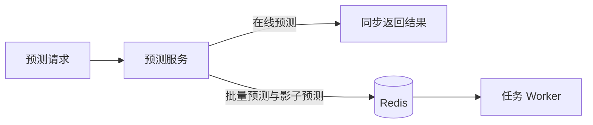

# 生产部署

本页介绍生产环境的部署架构、部署步骤和日常维护，并提供常见故障的排查方法。容器部署步骤见[Docker 部署](docker.md)，环境变量说明见[环境变量](../reference/environment-variables.md)。

## 部署架构

管理控制台负责模型管理与发布，预测服务负责处理在线请求，任务 Worker 负责执行批量预测和影子预测。三者共享数据库和模型文件存储，预测服务与任务 Worker 通过 Redis 消息队列传递异步任务。



**服务部署**

- **预测服务**：通过多个 Worker 接收 HTTP 请求并执行在线预测。各 Worker 独立加载模型，通过数据库中的运行控制记录协调加载状态，并上报运行实例状态。
- **管理控制台**：与预测服务分别启动，共用同一环境的数据库和模型文件存储。
- **任务 Worker**：通过 Celery 执行批量预测和影子预测，可按 `all`、`batch` 或 `shadow` 角色选择处理的任务类型。同一队列可由多个 Worker 共同消费。

**共享依赖**

- **PostgreSQL**：保存系统配置、请求、执行和任务状态，使用持久卷或托管数据库保存数据。
- **Redis**：提供异步任务队列。预测服务与任务 Worker 使用相同的 Redis 连接地址和队列名称。
- **模型文件存储**：可使用 MinIO 或本地目录，确保各模型加载进程均能访问模型文件。使用本地目录时，文件路径和内容须在各进程间保持一致。

## 部署步骤

### 安装

安装步骤请参阅[安装指南](../getting-started/installation.md)；使用容器部署时，请参阅[Docker 部署](docker.md)。

### 准备

创建 PostgreSQL 数据库，启动 Redis 消息队列服务，并检查数据库和消息队列的连接是否正常。为模型文件准备持久化存储：

- 使用默认的本地存储时，将模型目录挂载到持久卷或共享目录；
- 使用 MinIO 时，提前创建存储桶，并确认应用具有读写权限。

### 配置

通过环境变量或 `.env` 文件设置以下内容：

- **运行环境**：将 `DATAMIND_ENVIRONMENT` 设为 `production`。
- **服务连接**：配置数据库、模型文件存储和 Redis。
- **身份认证**：将 `DATAMIND_AUTH_ENABLED` 设为 `true`，通过 `DATAMIND_AUTH_SECRET_KEY` 设置随机生成的签名密钥。各应用进程须使用相同的签名密钥。
- **登录限制**：如需限制本地账户登录的来源网段，配置 `DATAMIND_AUTH_LOCAL_ALLOWED_NETWORKS`。
- **管理员账户**：首次初始化前，通过 `DATAMIND_INIT_ADMIN_PASSWORD` 设置管理员密码。修改该变量不会更新已有账户的密码。

配置示例见[配置与初始化](../getting-started/configuration.md)，更多说明见[环境变量](../reference/environment-variables.md)。

> **注意**
>
> 生产环境的凭据建议通过部署系统的密钥管理功能提供。使用 `.env` 文件时，应限制其读取权限。

### 数据库迁移与初始化

更新数据库结构：

```bash
datamind db upgrade
```

创建初始管理员账户和内置角色：

```bash
datamind init
```

> **注意**
>
> 数据库迁移应由单个进程执行。升级已有部署时，请先完成迁移，再更新应用。

### 启动服务

完成迁移与初始化后，运行以下命令启动预测服务：

```bash
datamind service run --host 0.0.0.0 --port 8700
```

在另一个终端启动管理控制台：

```bash
datamind console run --host 0.0.0.0 --port 8701
```

使用批量预测或影子预测时，启动任务 Worker：

```bash
datamind worker run
```

角色、队列和并发的配置方式请参阅[任务 Worker](worker.md)。

### 验证在线预测

通过 `/health` 和 `/ready` 检查服务状态。服务就绪后，注册并激活模型、启用部署，然后查看运行实例：

```bash
datamind runtime list
```

目标部署的运行实例状态为 `running` 后，发起[在线预测](../guides/online-prediction.md)请求，验证预测结果。

### 验证异步任务

- **批量预测**：发起[批量预测](../guides/batch-prediction.md)请求，等待批次执行结束，并核对各实例的预测结果。
- **影子预测**：按照[影子发布](shadow.md)配置路由，发起命中影子路由的请求，确认主预测正常返回，并生成独立的影子执行记录。

预测结果符合预期，日志、审计、任务队列和文件存储均无异常后，再接入生产流量。

## 容量与监控

### 监控指标

持续关注以下指标：

- **在线预测**：请求延迟和失败率。
- **模型加载**：运行实例心跳、加载状态和错误信息。
- **异步任务**：批次进度、任务失败率和影子任务积压。
- **基础服务**：Redis 内存、数据库连接数和模型文件存储空间。

`/health` 和 `/ready` 用于检查预测服务的健康与就绪状态。模型是否已加载、预测是否正常，仍需通过运行实例和实际请求验证。

### 连接池和内存

- **数据库连接池**：各进程独立维护连接池。配置 `DATAMIND_DATABASE_POOL_SIZE` 和 `DATAMIND_DATABASE_MAX_OVERFLOW` 时，需结合预测服务、管理控制台及任务 Worker 的进程总数，评估数据库连接数。
- **模型内存**：各预测服务 Worker 和任务 Worker 分别加载模型，增加进程数量前需评估模型的内存占用。

### 任务队列

批量分片大小和任务并发数分别控制任务规模与执行能力：

- `DATAMIND_TASK_QUEUE_BATCH_CHUNK_SIZE`：每个批量分片包含的请求数。
- `DATAMIND_TASK_WORKER_CONCURRENCY`：任务 Worker 的并发数。

设置 `DATAMIND_TASK_QUEUE_VISIBILITY_TIMEOUT_SECONDS` 时，应为任务执行预留充足时间，避免长任务在完成前被重新投递。

批次状态为 `queued` 表示等待处理，不代表任务 Worker 已取得消息。应结合队列积压和 Worker 日志判断消费情况。

## 备份与恢复

备份应包含以下内容：

- PostgreSQL 数据库；
- MinIO 模型文件桶或本地模型目录；
- 应用版本与部署配置。

数据库和模型文件的备份应保持一致。只备份数据库无法恢复模型文件，只备份模型文件无法恢复版本、路由和实验关系。备份完成后，应在隔离环境中验证恢复流程。

恢复时按以下顺序操作：

1. 准备基础设施与凭据，还原数据库和模型文件。
2. 使用兼容的应用版本启动，检查数据库迁移和模型文件可读性。
3. 检查预测服务就绪状态和部署运行实例，完成一次实际预测。
4. 使用批量或影子能力时，提交新任务验证消息队列和任务 Worker。

模型加载出现问题时，应检查文件访问和运行依赖，不要直接编辑数据库状态。

## 升级和回滚

### 升级

升级前，记录当前镜像和数据库迁移版本，完成数据备份，并在测试环境验证迁移及已有模型的兼容性。生产镜像应使用固定版本标签，框架依赖应与模型匹配。

确认验证通过后，先执行数据库迁移，再滚动更新应用，最后验证在线预测与异步任务。

### 回滚

应用与数据库需分别回滚，切换旧镜像不会自动恢复数据库。若需回退数据库结构，可使用以下命令：

```bash
datamind db downgrade --revision <revision>
```

将 `<revision>` 替换为目标迁移版本，使用 `-1` 可回退一步。命令默认要求确认，自动化执行时可添加 `--yes`。

> **注意**
>
> 降级前应备份数据，并确认数据库结构与应用版本兼容。当前仅有初始迁移，回退一步或降级到 `base` 会删除业务表。迁移降级无法恢复已丢失的数据，数据恢复需使用备份。

<a id="troubleshooting" name="troubleshooting"></a>

## 常见故障排查

排查故障时，先记录发生时间和服务环境，并收集相关的 `request_id`、`batch_id` 和 `deployment_id`。

### `/ready` 返回 HTTP 503

1. 分别调用 `/health` 和 `/ready`，检查服务的健康与就绪状态：

   ```bash
   curl -i -X POST http://127.0.0.1:8700/health \
     -H "Content-Type: application/json" \
     -d '{}'

   curl -i -X POST http://127.0.0.1:8700/ready \
     -H "Content-Type: application/json" \
     -d '{}'
   ```

2. 根据响应结果排查：

   - `/health` 无法连接：检查预测服务是否运行，以及监听地址、端口和代理配置是否正确。
   - `/health` 返回 200、`/ready` 返回 503：服务可以响应，但数据库连接或协调循环异常。检查服务日志、`DATAMIND_DATABASE_URL` 及数据库访问权限。
   - 两者均返回 200：服务已就绪。如预测仍失败，继续检查运行实例状态。

3. 修复后，确认 `/ready` 返回 HTTP 200 且 `status` 为 `ready`，再检查运行实例并发送预测请求，验证恢复结果。

> **提示**
>
> `/ready` 通过仅表示数据库连接和协调循环正常，不代表数据库迁移完整或模型已加载。

### 部署已启用，但预测失败

1. 查看部署配置和运行实例状态：

   ```bash
   datamind deployment show <deployment_id>
   datamind runtime show <deployment_id>
   ```

2. 核对以下状态：

   - 部署状态为 `active`，环境与预测服务的 `DATAMIND_ENVIRONMENT` 一致。
   - 运行控制的 `desired_status` 为 `loaded`。
   - 各预测服务 Worker 均有对应的运行实例，状态为 `running`，心跳持续更新。
   - 运行实例的 `applied_generation` 与 `control.generation` 一致，`error` 为 `null`。

   如实例为 `failed` 或存在错误，结合服务日志检查模型文件权限、文件摘要、模型框架依赖，以及各实例能否访问模型目录。

3. 修复后，重新加载部署：

   ```bash
   curl -sS http://127.0.0.1:8700/admin/reload \
     -H "Authorization: Bearer <access_token>" \
     -H "Content-Type: application/json" \
     -d '{"request":{"deployment_id":"<deployment_id>"}}'
   ```

4. 确认实例恢复为 `running` 后，再验证预测。先指定 `deployment_id` 发送请求，确认模型可执行；再通过模型路由发送请求，检查路由是否正常。

### 预测路由失败

1. 使用相同输入，分别发送定向预测和普通预测请求。定向请求指定 `deployment_id`，普通请求不指定，请求格式见[在线预测](../guides/online-prediction.md)。若定向预测成功、普通预测失败，继续检查路由配置。

2. 查看当前环境的部署、已启用的路由和运行实例状态：

   ```bash
   datamind deployment list --model-id <model_id> --status active
   datamind route list --enabled
   datamind deployment show <deployment_id>
   datamind runtime show <deployment_id>
   ```

3. 根据错误信息排查：

   - **没有可用部署**：检查部署是否已启用、环境是否一致，以及是否处于生效期内。未匹配到普通路由时，还需确认已设置可用的默认部署。
   - **路由匹配异常**：检查路由是否启用，以及匹配条件、比例约束和规则结构是否正确。
   - **实验请求异常**：检查实验及其分组状态。

   没有匹配的普通路由时，系统使用默认部署，不会自动选择其他部署。具体决策顺序见[流量分配与决策优先级](../routing/index.md)。

4. 修复后，重新发送不带 `deployment_id` 的请求。确认响应为 `success=true`，再通过返回的 `request_id`，在管理控制台的请求与执行记录中核对实际部署和版本。

### 批次长时间停留在 `queued`

1. 使用提交时返回的 `batch_id` 查询批次状态：

   ```bash
   curl -sS http://127.0.0.1:8700/predict/batch/status \
     -H "Authorization: Bearer <access_token>" \
     -H "Content-Type: application/json" \
     -d '{"request":{"batch_id":"<batch_id>"}}'
   ```

2. 检查任务队列和 Worker 配置：

   - 预测服务与任务 Worker 的 `DATAMIND_TASK_QUEUE_BROKER_URL` 指向同一 Redis。
   - Worker 角色为 `batch` 或 `all`，且 `DATAMIND_TASK_QUEUE_BATCH_QUEUE` 与任务生产端一致。
   - Worker 日志显示 Redis 已连接，并正在消费目标队列。

3. 根据现象判断原因：

   - **提交时报 `TaskDispatchError`**：任务未成功发布。
   - **持续为 `queued`，计数不变**：检查是否缺少匹配的 Worker，或队列名称不一致。
   - **进入 `running` 后停滞**：检查 Worker 日志、模型执行耗时及 `DATAMIND_TASK_QUEUE_VISIBILITY_TIMEOUT_SECONDS`。

4. 恢复 Redis 连接或修正 Worker 配置后，继续观察原批次。确认状态最终进入终态，并核对成功数、失败数和逐条结果。

> **提示**
>
> 仅 `cancelled`、`partially_succeeded` 和 `failed` 批次支持重试，不能通过重试推动仍处于 `queued` 状态的批次。

### 没有影子执行结果

1. 确认预测服务已启用 `DATAMIND_RUNTIME_SHADOW_ENABLED`，并查看当前环境中已启用的影子路由：

   ```bash
   datamind route list --rollout shadow --enabled
   ```

2. 检查影子路由绑定的部署、流量比例、匹配规则和生效时间。比例小于 1 时，单次请求未命中属于正常情况。

3. 检查任务 Worker：

   - 角色为 `shadow` 或 `all`。
   - 与预测服务连接同一 Redis，并使用相同的 `DATAMIND_TASK_QUEUE_SHADOW_QUEUE`。
   - 根据请求的 `request_id` 查看执行记录，确认影子任务是否创建、是否仍在排队，或是否执行失败。

4. 修复后，发送符合路由规则的预测请求。确认主响应仍来自主部署，并产生独立的 `shadow` 执行记录。

> **提示**
>
> 系统不提供针对任意历史影子执行的公开重试接口。

### 出现 401 或 403

1. 记录请求的 HTTP 状态、`error_type` 和 `request_id`，根据状态码排查：

   - **401**：凭据缺失、过期或签名校验失败。
   - **403**：身份认证通过，但缺少所需权限。

2. 认证失败时，调用 `/auth/login` 重新获取访问令牌。若同一令牌的请求间歇性失败，检查各预测服务进程使用的认证签名密钥是否一致。

3. 权限不足时，检查用户、角色和权限：

   ```bash
   datamind user show <username>
   datamind role show <role_name>
   ```

4. 修复后，重新发送原请求，确认访问恢复正常。

> **提示**
>
> 登录成功不代表拥有目标接口的访问权限，应以原请求的验证结果为准。

### 审计写入失败

当 `DATAMIND_AUDIT_FAILURE_MODE=closed` 时，审计写入失败会阻止相关管理操作。可按以下步骤排查：

1. 查看响应中的错误类型和审计日志，确认失败原因。
2. 检查数据库连接及写入权限。
3. 修复后，重新执行原操作。

> **注意**
>
> 不要直接修改数据库来绕过审计和生命周期校验。
