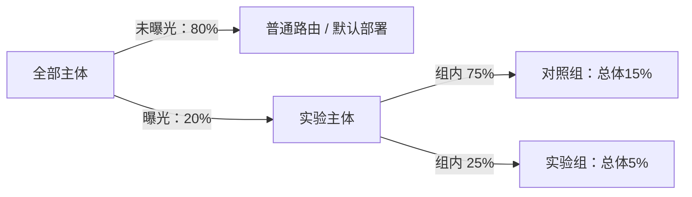
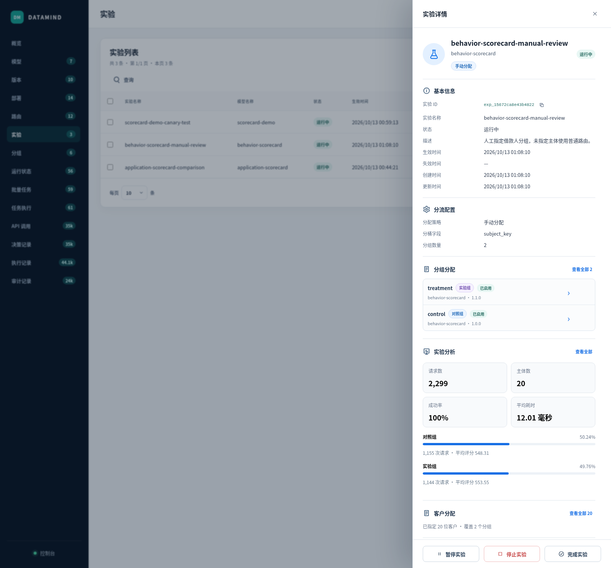

# 实验分配

实验分配用于确定主体是否参与实验，以及所属的实验分组。系统保存首次有效分配记录（`Assignment`），同一主体的后续请求复用已有分配。

## 参与条件

请求参与实验分配需满足以下条件：

- 存在与请求模型和运行环境匹配的运行中实验（`running`）。
- 实验处于生效时间内：当前时间不早于 `effective_from`，且早于 `effective_to`；未设置的时间边界不作限制。
- 能够解析出非空主体标识。
- 实验配置和有效分组满足所选分配策略的约束。

同一模型在同一环境中存在多个生效的运行中实验时，系统返回配置错误，不会按创建时间或名称选择实验。

## 主体标识

主体标识（`subject_key`）用于识别参与实验的主体。同一主体的请求应使用相同标识，因此应选用稳定的主体 ID。主体类型（`subject_type`）只记录主体类别，不参与哈希。主体标识按以下顺序解析：

1. 优先使用请求中非空的 `subject_key`。
2. 未提供 `subject_key` 或其值为空时，系统读取请求载荷中 `features` 对象中由 `bucket_key` 指定的顶层字段值作为主体标识。

该字段支持非空字符串或整数，整数转换为字符串，不接受布尔值。无法解析主体标识时，请求不参与实验。批量预测按各实例分别解析主体标识。

例如，实验配置为 `bucket_key=borrower_id`，请求中是否提供 `subject_key` 会影响主体标识的取值：

**未提供 `subject_key`：使用 `borrower-001` 作为主体标识**

```json
{
  "request": {
    "model_name": "scorecard-demo",
    "features": {
      "borrower_id": "borrower-001",
      "age": 35
    }
  }
}
```

主体标识来自 `features.borrower_id`。

**显式提供 `subject_key`：使用 `customer-001` 作为主体标识**

```json
{
  "request": {
    "model_name": "scorecard-demo",
    "subject_key": "customer-001",
    "features": {
      "borrower_id": "borrower-001",
      "age": 35
    }
  }
}
```

主体标识来自 `subject_key`，优先于 `features.borrower_id`。

> **注意**
>
> `bucket_key` 只能读取 `features` 对象的顶层字段。例如，`bucket_key=borrower_id` 无法读取嵌套的 `features.customer.borrower_id`。`bucket_key` 只用于识别主体，不会自动修改或补充模型特征。
>
> 同一主体的请求应使用相同标识。客户 ID（`customer_id`）可用于稳定识别主体，而请求 ID（`request_id`）标识单次请求，不适合作为主体标识。

## 分配策略

### 哈希分配

`hash` 策略使用两个独立的 SHA-256 哈希空间，分别判断主体是否进入实验和选择实验分组，使实验曝光与实验分组相互独立。

**实验曝光**

曝光值由实验 ID（`experiment_id`）和主体标识（`subject_key`）共同决定：

```text
exposure = SHA-256("{experiment_id}:{subject_key}") 映射到 [0, 1)
```

当曝光值 `exposure` 小于实验曝光比例 `traffic_ratio` 时，主体进入实验；否则不创建分配记录，请求继续按普通路由处理。

例如，将 `traffic_ratio` 设为 `0.20`，曝光值位于 `[0, 0.20)` 的主体进入实验，其余主体不参与实验。

**实验分组**

进入实验后，使用独立哈希值计算分组位置：

```text
point = SHA-256("{experiment_id}:{subject_key}:variant") 映射到 [0, 1)
```

实验分组按以下步骤确定：

1. 筛选状态为 `active` 且权重大于 0 的分组，按 `variant_id`、`name` 排序。
2. 按各分组的权重（`weight`）依次划分区间。
3. 根据分组位置（`point`）所在的区间，选择对应分组。

例如，两个分组均为 `active`，对照组权重为 `0.75`，实验组权重为 `0.25`。按 `variant_id`、`name` 排序后，区间划分如下：

**对照组排在前面**

| 分组   | `variant_id` | 权重（`weight`） | 分组区间    |
|--------|--------------|------------------|-------------|
| 对照组 | `var_001`    | `0.75`           | `[0, 0.75)` |
| 实验组 | `var_002`    | `0.25`           | `[0.75, 1)` |

- `point=0.30`：落入 `[0, 0.75)`，选择对照组。
- `point=0.80`：落入 `[0.75, 1)`，选择实验组。

**实验组排在前面**

| 分组   | `variant_id` | 权重（`weight`） | 分组区间    |
|--------|--------------|------------------|-------------|
| 实验组 | `var_001`    | `0.25`           | `[0, 0.25)` |
| 对照组 | `var_002`    | `0.75`           | `[0.25, 1)` |

- `point=0.30`：落入 `[0.25, 1)`，选择对照组。
- `point=0.80`：落入 `[0.25, 1)`，选择对照组。

排序决定区间位置，权重决定区间大小。

**分组占比**

分组在全部主体中的预期占比为 `traffic_ratio × weight`。

例如，实验曝光比例为 20%，对照组权重为 75%，实验组权重为 25%，各组在全部主体中的预期占比如下：



实验分组绑定的部署可用时，参与实验的主体由对应分组选择部署；未参与实验的主体继续按普通路由和默认部署处理。

> **注意**
>
> 实验曝光比例（`traffic_ratio`）的取值范围为 `(0, 1]`。参与分配的分组权重之和必须为 1，允许的数值误差为 `1e-8`。
>
> 分组区间由排序和权重共同决定，对照组不一定位于第一个区间。权重为 0 的分组不参与自动分配。
>
> 上述比例表示主体的预期占比，有限样本的实际占比可能有所偏差。实验曝光比例独立计算，不计入普通路由的流量比例。

在管理控制台创建或编辑草稿实验时，选择哈希分配（`hash`），并设置实验曝光比例和各分组的权重。实验详情展示分配策略、曝光比例和分组权重：


### 手动分配

`manual` 策略通过主体分配映射（`manual_assignments`）指定每个主体的实验分组，不按曝光比例筛选主体，也不按权重自动分组：

```json
{
  "strategy": "manual",
  "manual_assignments": {
    "borrower-001": "<control_variant_id>",
    "borrower-002": "<treatment_variant_id>"
  }
}
```

未配置映射的主体不参与实验，按普通路由分配。

> **注意**
>
> 映射的实验分组须属于当前实验，状态为 `active`，且权重大于 0。手动分配实验仍需包含一个启用的对照组和至少一个启用的实验组；分组权重不用于计算流量比例。

在管理控制台创建或编辑草稿实验时，选择手动分配（`manual`），并设置主体与实验分组的映射。实验详情展示分配策略、分组配置和主体映射：



## 分配记录与分组稳定性

首次分配后，系统保存主体与实验分组的分配记录。同一主体再次请求时，复用已有分配记录，不重新分组。原分组被删除或停用时，请求按普通路由和默认部署处理，不改分到其他实验分组。

分组绑定的部署还须满足以下条件：

- 部署的模型与请求调用的模型一致。
- 部署所在的环境与预测服务的运行环境一致。
- 状态为 `active`，且处于有效期内。
- 不是影子部署。

实验分组或其绑定的部署不可用时，请求由普通路由或默认部署处理。

> **注意**
>
> 为保持分组稳定，请勿在实验运行期间停用分组、替换部署或调整曝光比例和分组权重。如需调整这些配置，请创建新实验。

## 与路由的关系

请求未指定 `deployment_id` 时，优先进行实验分配。实验未选中可用部署时，请求由普通路由或默认部署处理。完整优先级见[流量分配与决策优先级](../routing/index.md)。

| 场景                                 | 主部署如何确定           | 后续行为                                 |
|--------------------------------------|--------------------------|------------------------------------------|
| 请求指定 `deployment_id`             | 使用并严格校验指定部署   | 跳过实验和普通路由                       |
| 主体已有有效分配记录，且分组部署可用 | 使用已分配分组绑定的部署 | 跳过普通路由                             |
| 哈希策略下主体未曝光                 | 实验不产生结果           | 继续普通路由，再视情况回退默认部署       |
| 手动策略下主体未映射                 | 实验不产生结果           | 继续普通路由，再视情况回退默认部署       |
| 实验配置非法                         | 无法完成主路由决策       | 返回路由错误，不静默回退                 |
| 主部署已确定                         | 保持已选部署             | 按影子路由配置执行预测，不影响主预测结果 |

实验暂停、停止或完成后，请求不再通过该实验分配。暂停的实验可重新启动，并在生效期内复用已有分配记录；已停止或完成的实验不能重新启动。

> **提示**
>
> 暂停后可恢复实验；停止后无法再次启动。

了解如何创建实验及评估结果，请参阅 [A/B 测试](index.md)和[实验分析](analysis.md)。
