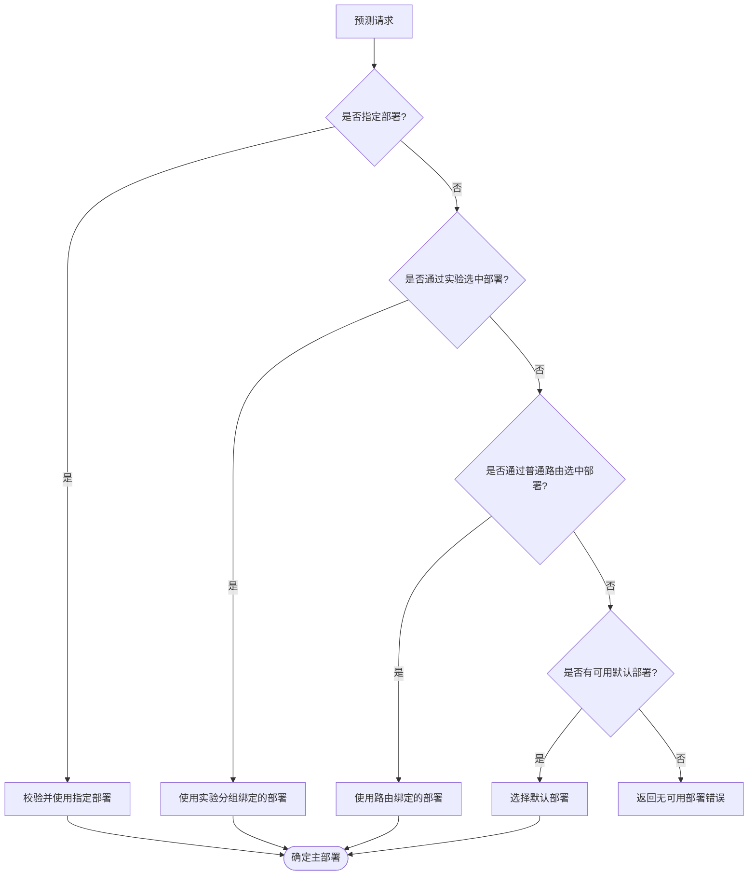

# 流量分配与决策优先级

流量分配决定预测请求由哪个部署处理，以及是否复制到影子部署。

- **主部署**：处理请求并返回预测结果。
- **影子部署**：按配置接收请求副本，异步执行，用于比较不同版本的表现。

每次请求的部署选择与分配依据，均可通过决策与执行记录追溯。

## 主部署选择

预测请求可以直接指定部署，也可以通过实验分配或普通路由选择部署。请求指定的部署优先于实验分配，实验分配优先于普通路由；均未选中部署时，回退到默认部署。主部署确定后，不再尝试优先级更低的选择方式。



具体规则如下：

1. **指定部署**：请求指定 `deployment_id` 时，校验并使用该部署，跳过实验分配和普通路由。
2. **实验分配**：未指定部署时，进行实验分配。若获得有效分配且分组绑定的部署可用，则使用该部署。
3. **普通路由**：实验未选中可用部署时，匹配普通路由，并按流量比例选择路由绑定的部署。
4. **默认部署**：普通路由未选中部署时，使用[默认部署](#默认部署)。

无论采用哪种选择方式，主部署都需满足以下条件：

- 部署的模型与请求调用的模型一致。
- 部署所在的环境与预测服务的运行环境一致。
- 部署已启用，且处于生效期内。
- 不是影子部署。

具体选择规则见[实验分配](../experiments/assignment.md)、[普通路由分配](#普通路由分配)和[默认部署](#默认部署)。

> **注意**
>
> 以下情况会直接报错，不会回退到其他部署：
>
> - 指定的部署未通过校验。
> - 同一模型在同一环境中存在多个有效的运行中实验，或参与分配的实验比例、分组权重无效。
> - 参与普通路由分配的流量比例无效。
>
> 若最终没有可用部署，请求将返回无可用部署错误。

## 普通路由分配

普通路由通过哈希计算为请求确定分桶位置，并按候选路由的流量比例划分区间。分桶位置落入哪个区间，请求就分配到该路由绑定的部署。

参与分配的路由需同时满足以下条件：

- 路由所在的环境与预测服务的运行环境一致。
- 路由已启用，且处于生效期内。
- 路由规则与请求输入匹配。
- 绑定的部署对应请求调用的模型，且与路由处于同一环境。
- 绑定的部署已启用，且处于生效期内。
- 绑定的部署不是影子部署。

### 确定分桶位置

分桶位置由模型（`model_id`）、运行环境（`environment`）和路由键（`routing_key`）共同决定。路由键取请求中的 `subject_key`；未提供或为空时，使用 `model_id`。

```text
u = SHA-256("routing:{model_id}:{environment}:{routing_key}") 映射到 [0, 1]
```

同一主体的请求使用相同的模型、环境和路由键时，分桶位置保持不变。若要按客户、订单等主体分配流量，请提供稳定的 `subject_key`。未提供或为空时，使用 `model_id` 作为路由键，同一模型在同一环境中的请求会落在同一分桶位置。

### 按比例选择部署

候选路由按 `routing_id` 的字典序排列，每条路由的流量比例决定其区间大小。

以下示例中，路由 A、B、C 按此顺序排列，流量比例为 `0.10`、`0.20`、`0.30`：

| 路由   | 流量比例 | 路由区间       | 说明         |
|--------|----------|----------------|--------------|
| 路由 A | `0.10`   | `[0, 0.10)`    | 绑定部署 A   |
| 路由 B | `0.20`   | `[0.10, 0.30)` | 绑定部署 B   |
| 路由 C | `0.30`   | `[0.30, 0.60)` | 绑定部署 C   |
| —      | 剩余流量 | `[0.60, 1]`    | 使用默认部署 |

各候选路由的流量比例之和不得超过 1，比例为 0 的路由不分配主流量。各路由按配置比例分配，未覆盖的区间使用默认部署。调整流量比例会改变路由区间，但不会改变请求的分桶位置。

> **注意**
>
> 每次请求只在符合路由规则的候选路由中分流。未匹配的候选路由不参与分流，后续路由的区间会随之前移。因此，配置的流量比例表示区间大小，不一定等于部署在全部请求中的实际流量占比。

例如，两条路由按 A、B 的顺序排列。A 匹配年龄 ≥ 30 的请求，B 无条件限制。

**年龄为 35：两条路由均匹配**

| 路由 | 流量比例 | 路由区间       | 说明       |
|------|----------|----------------|------------|
| A    | 10%      | `[0, 0.10)`    | 绑定部署 A |
| B    | 20%      | `[0.10, 0.30)` | 绑定部署 B |

**年龄为 25：A 不匹配，B 的区间前移**

| 路由 | 流量比例 | 路由区间    | 说明       |
|------|----------|-------------|------------|
| A    | 10%      | —           | 不参与分流 |
| B    | 20%      | `[0, 0.20)` | 绑定部署 B |

假设两次请求的分桶位置均为 `0.25`，年龄为 35 时使用部署 B，年龄为 25 时使用默认部署。B 的流量比例没有变化，但规则匹配结果改变了它的区间位置，因此同一分桶位置的请求可能被分配到不同的部署。

### 保持分配稳定

普通路由每次请求都会重新匹配规则。同一主体的分桶位置保持不变，且参与分流的路由及其比例一致时，请求会持续选择同一路由。

路由启停、规则匹配结果或流量比例发生变化时，即使分桶位置不变，请求也可能被分配到不同的部署。

普通路由不保存分配记录。实验分配会保存主体的分配记录（`Assignment`），同一主体的后续请求沿用原有分组，不重新分配。更多说明，请参阅[实验分配](../experiments/assignment.md)。

## 默认部署

默认部署是实验分配和普通路由都未选中部署时的回退目标。请求显式指定 `deployment_id` 时，不使用默认部署。

同一模型在同一环境中只能指定一个默认部署，但可以启用多个 `champion` 部署。默认部署必须是已启用且处于生效期内的非影子 `champion` 部署，其模型和环境分别与请求调用的模型、预测服务的运行环境一致。

### 设置与切换

确认目标部署的运行实例状态为 `running` 后，将其设为默认部署：

```bash
datamind deployment set-default <deployment_id>
```

如果已有默认部署，该命令会替换原默认部署。切换不会停用原部署，也不会修改路由。

### 取消默认部署

```bash
datamind deployment unset-default <deployment_id>
```

取消后，该部署仍可通过指定部署或普通路由接收请求。

停用默认部署也会清除默认标记。重新启用后，如需继续接收默认流量，应再次执行 `set-default`。

> **注意**
>
> 请求回退到默认部署时，若未设置默认部署，或默认部署已不可用，将返回路由错误，不会自动选择其他 `champion` 或 `challenger` 部署。

## 影子流量分配

启用影子预测后，每次请求先确定主部署，再筛选影子路由。参与采样的路由需满足以下条件：

- 路由与预测服务处于同一环境。
- 路由已启用，且处于生效期内。
- 路由规则与请求载荷匹配；空规则匹配所有请求。
- 绑定的部署是影子部署，模型与请求调用的模型一致。
- 绑定的部署已启用、处于生效期内，且与预测服务处于同一环境。

### 独立采样

影子路由的采样值 `u` 由模型（`model_id`）、运行环境（`environment`）、路由 ID（`routing_id`）和路由键（`routing_key`）共同决定。

```text
u = SHA-256("shadow:{model_id}:{environment}:{routing_id}:{routing_key}") 映射到 [0, 1]
```

> **提示**
>
> 路由键取请求中的 `subject_key`；未提供或为空时，使用 `model_id`，取值方式与普通路由一致。

当 `u < traffic_ratio` 时，请求命中该影子路由。各条路由独立采样，一次请求可以命中多个影子部署。影子采样比例独立设置，不计入普通路由的比例总和，也不受普通路由比例限制。

例如，请求未指定部署，也未进入实验。普通路由 A、B 不设匹配规则，分别分配 10% 和 20% 的主流量；影子路由 S 按 50% 的比例采样。

**S 未配置规则：对全部请求采样**

| 流量类型 | 配置       | 比例     | 说明                                   |
|----------|------------|----------|----------------------------------------|
| 主流量   | 普通路由 A | 10%      | 由部署 A 处理                          |
| 主流量   | 普通路由 B | 20%      | 由部署 B 处理                          |
| 主流量   | 默认部署   | 剩余 70% | 由默认部署处理                         |
| 影子流量 | 影子路由 S | 50%      | 对全部请求采样，命中后复制到影子部署 S |

每个请求由 A、B 或默认部署中的一个处理，同时独立判断是否命中 S。影子路由 S 按 50% 的比例对全部请求采样，不受主流量分配比例的影响。

**S 已配置规则：只对符合规则的请求采样**

| 请求            | 采样比例 | 说明                                         |
|-----------------|----------|----------------------------------------------|
| 符合 S 的规则   | 50%      | 对符合规则的请求采样，命中后复制到影子部署 S |
| 不符合 S 的规则 | —        | 不参与影子采样                               |

影子路由 S 按 50% 的比例对符合规则的请求采样。主流量仍按普通路由和默认部署的配置分配。

> **注意**
>
> 影子路由按配置比例对符合规则的请求采样，因此该比例不一定等于影子部署在全部请求中的实际流量占比。

### 异步执行

命中后，请求副本通过队列交由影子部署异步执行，不影响主预测结果。同一请求中，每个影子部署最多执行一次，与主部署相同的目标会被排除。

## 配置字段

| 字段             | 说明                                                               |
|------------------|--------------------------------------------------------------------|
| `deployment_id`  | 路由绑定的部署 ID；每个部署最多关联一条未删除的路由                |
| `environment`    | 路由的运行环境，须与绑定部署的环境一致                             |
| `traffic_ratio`  | 取值范围为 `[0, 1]`；表示普通路由的区间大小，或影子路由的采样比例  |
| `enabled`        | 是否启用路由；创建路由时默认停用                                   |
| `rules`          | 请求匹配规则；未设置或为空时，匹配所有请求                         |
| `effective_from` | 生效开始时间，满足 `effective_from <= now`；未设置时不限制开始时间 |
| `effective_to`   | 生效结束时间，满足 `now < effective_to`；未设置时不限制结束时间    |
| `rollout_type`   | 创建路由时复制绑定部署的 `rollout_type`，记录发布类型              |
| `rollout_group`  | 创建路由时复制绑定部署的 `role`，记录部署角色                      |

影子部署的判定以部署当前配置为准，满足以下任一条件即可：

- 发布类型 `rollout_type` 为 `shadow`。
- 部署角色 `role` 为 `shadow`。

生效开始时间和生效结束时间统一以 UTC 为准。更多关于路由规则配置，请参阅[路由规则](rules.md)。更多关于发布流程请参阅[全量发布](../deployment/full.md)、[金丝雀发布](../deployment/canary.md)和[影子发布](../deployment/shadow.md)。
